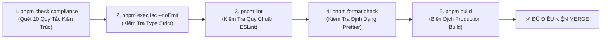

# HƯỚNG DẪN & TIÊU CHÍ KIỂM TRA TUÂN THỦ QUY TẮC CODE (CODE COMPLIANCE AUDIT)

## HỆ THỐNG QUẢN TRỊ NỘI DUNG CMS - DIỄN ĐÀN KINH TẾ DI SẢN (HERITAGE ECONOMY FORUM - HEF)

**Phiên bản tài liệu:** 1.0 (Áp dụng từ 03/11/2026)  
**Tiêu chuẩn gốc:** [`docs/HEF_CMS_CODING_RULES.md`](./HEF_CMS_CODING_RULES.md) & [`AI_INSTRUCTIONS.md`](../AI_INSTRUCTIONS.md)

---

> [!IMPORTANT]
> **MỤC ĐÍCH TÀI LIỆU:**  
> Tài liệu này cung cấp bộ công cụ tự động và checklist kiểm tra độc lập để xác định xem bất kỳ đoạn mã nguồn nào do Lập trình viên hoặc AI Agents sinh ra **ĐÃ TUÂN THỦ ĐẦY ĐỦ QUY TẮC HAY CHƯA** trước khi commit hoặc merge vào nhánh chính (`main`).

---

## 1. QUY TRÌNH KIỂM TRA TỰ ĐỘNG (AUTOMATED AUDIT PIPELINE)

Mọi code thay đổi BẮT BUỘC phải vượt qua 5 lệnh kiểm tra tự động theo thứ tự dưới đây:



### Lệnh chạy nhanh toàn bộ Pipeline:

```bash
# 1. Quét kiểm tra 10 quy tắc kiến trúc bắt buộc
pnpm check:compliance

# 2. Kiểm tra type TypeScript nghiêm ngặt (0 errors)
pnpm exec tsc --noEmit

# 3. Kiểm tra ESLint Next.js & React 19 (0 errors, 0 warnings)
pnpm lint

# 4. Kiểm tra định dạng code Prettier
pnpm format:check

# 5. Kiểm tra build sản phẩm thực tế
pnpm build
```

---

## 2. MA TRẬN 10 TIÊU TRÍ KIỂM TRA TUÂN THỦ (10-POINT COMPLIANCE MATRIX)

|  STT   | Tiêu Chí Kiểm Tra                              |      Mức Độ       | Cách Nhận Biết Đạt Chuẩn                                                                                                                        | Hậu Quả Nếu Vi Phạm                                               |
| :----: | :--------------------------------------------- | :---------------: | :---------------------------------------------------------------------------------------------------------------------------------------------- | :---------------------------------------------------------------- |
| **01** | **Cấu trúc 7 Layer trong Feature Module**      | **P0 (Blocker)**  | Thư mục `src/features/<feature>/` có đủ: `types/`, `schemas/`, `repositories/`, `services/`, `actions/`, `hooks/`, `components/` và `index.ts`. | Phá vỡ Clean Architecture, gây phụ thuộc vòng chéo.               |
| **02** | **Cấm truy cập Prisma trực tiếp từ UI/Action** | **P0 (Blocker)**  | Không có từ khóa `prisma.<model>` trong `src/components/`, `src/app/`, hoặc `actions/`. BẮT BUỘC gọi qua Service.                               | Lộ ranh giới truy cập dữ liệu, bypass logic nghiệp vụ.            |
| **03** | **Bảo vệ ranh giới Repository**                | **P0 (Blocker)**  | File `src/features/<feature>/index.ts` TUYỆT ĐỐI KHÔNG export class Repository instance. Chỉ export Service, DTO, Schema, Action.               | Tầng ngoài có thể gọi tắt Repository mà bỏ qua Service.           |
| **04** | **Tuân thủ chuẩn Prisma 7**                    | **P0 (Blocker)**  | File `src/prisma/schema.prisma` KHÔNG chứa chỉ thị `url = env(...)`. URL cấu hình migrate đặt tại `prisma.config.ts`.                           | Lỗi biên dịch Prisma 7 khi chạy `prisma generate` hoặc `migrate`. |
| **05** | **MariaDB Pool Singleton Client**              | **P1 (Critical)** | Mọi truy vấn database BẮT BUỘC sử dụng singleton `prisma` từ `@/lib/prisma`. Driver adapter là `@prisma/adapter-mariadb`.                       | Tràn connection pool MariaDB khi có lưu lượng truy cập cao.       |
| **06** | **Graceful Fallback khi CSDL Offline**         | **P1 (Critical)** | Mọi Repository đều bọc `try/catch` và có sẵn dữ liệu mẫu (`DEFAULT_HEF_PAGES` / mock data) phòng khi CSDL chưa kết nối.                         | Ứng dụng và tiến trình build CI/CD bị crash khi DB bảo trì.       |
| **07** | **Design Tokens Màu & Typography Di Sản**      | **P1 (Critical)** | Sử dụng đúng 4 mã màu: Đỏ son (`#76232D`), Vàng đồng (`#C29B57`), Ngà voi (`#F5EFE5`), Đen than (`#292929`). Tiêu đề dùng `font-serif`.         | Sai lệch bộ nhận diện thương hiệu quốc gia của Đề án HEF.         |
| **08** | **Bộ Icon Component System Chuẩn Hóa**         | **P1 (Critical)** | Dùng `<HefIcon />` (với các variant màu) và `<BrandLogo />` từ `@/components/icons`. CẤM import icon tự do không bọc.                           | Giao diện manh mún, không đồng bộ kích thước và màu sắc.          |
| **09** | **Kiến trúc Dynamic Sections JSON CMS**        | **P0 (Blocker)**  | 7 trang chuyên đề được lưu tại bảng `pages`, quản trị thông qua mảng `sections JSON`. Có giao diện quản trị tại `/admin/dashboard`.             | Không thể kéo thả/bật tắt section linh hoạt từ CMS.               |
| **10** | **Múi Giờ Việt Nam (GMT+7) & Cổng SSO**        | **P1 (Critical)** | Ngày giờ format qua `@/lib/format-date` (Asia/Ho_Chi_Minh). Cổng đăng nhập `/login` tích hợp SSO VNeID, CQNN, Enterprise.                       | Hiển thị sai ngày giờ Việt Nam; thiếu cơ chế xác thực đại biểu.   |

---

## 3. CHECKLIST ĐÁNH GIÁ NHANH TRƯỚC KHI TẠO PULL REQUEST (PR GATE)

Mỗi nhà phát triển hoặc AI Agent khi hoàn thành task BẮT BUỘC đánh dấu tích vào danh sách sau:

- [ ] **Kiến Trúc & Ranh Giới:**
  - [ ] Module mới nằm trong `src/features/<feature-name>/`.
  - [ ] Không import trực tiếp `prisma` trong component UI hay action.
  - [ ] File `index.ts` không export Repository.
- [ ] **Xác Thực & An Toàn Dữ Liệu:**
  - [ ] Mọi dữ liệu đầu vào (Form / Query / Params) đều được validate bằng **Zod Schema**.
  - [ ] Dùng `safeParse` hoặc helper `apiValidationError` khi xử lý lỗi.
- [ ] **Giao Diện & Nhận Diện Di Sản:**
  - [ ] Màu sắc tuân thủ: Đỏ son (`#76232D`), Vàng đồng (`#C29B57`), Ngà voi (`#F5EFE5`).
  - [ ] Tiêu đề dùng phông chữ Serif (`font-serif`).
  - [ ] Icon sử dụng component `<HefIcon name="..." variant="..." />`.
- [ ] **Múi Giờ & Thời Gian:**
  - [ ] Toàn bộ ngày giờ hiển thị trên giao diện đều định dạng theo chuẩn Việt Nam qua `formatDateVN()` hoặc `formatDateTimeVN()`.
- [ ] **Chất Lượng Mã Nguồn:**
  - [ ] `pnpm check:compliance` đạt **100% (10/10 PASSED)**.
  - [ ] `pnpm exec tsc --noEmit` báo **0 errors**.
  - [ ] `pnpm lint` báo **0 errors, 0 warnings**.
  - [ ] `pnpm format` đã được chạy để căn chỉnh code chuẩn Prettier.
  - [ ] `pnpm build` biên dịch thành công không có lỗi webpack hay prerender.

---

## 4. TÍCH HỢP ARCHIFY & SINH SƠ ĐỒ KIẾN TRÚC

Hệ thống đã tích hợp công cụ mô hình hóa kiến trúc **Archify** (`tt-a1i/archify`):

### 4.1. Cấu Trúc File Archify

1. **File Đặc Tả JSON IR:**
   - Đường dẫn: [`docs/architecture/hef-system-architecture.archify.json`](./architecture/hef-system-architecture.archify.json)
   - Chứa toàn bộ định nghĩa về 6 Boundary Tiers, 15 Components, và 14 Đường liên kết dữ liệu định hướng.
2. **File Trực Quan Hóa HTML Tương Tác:**
   - Đường dẫn: [`docs/architecture/hef-architecture.html`](./architecture/hef-architecture.html)
   - Cung cấp giao diện trực quan độc lập, có thể mở trực tiếp trên trình duyệt, có tính năng **Component Inspector** hiển thị chi tiết ranh giới layer và liên kết của từng thành phần.
3. **Agent Skill:**
   - Đường dẫn: [`.agent/skills/archify/SKILL.md`](../.agent/skills/archify/SKILL.md)

### 4.2. Lệnh Tái Sinh Sơ Đồ Kiến Trúc:

Khi có thay đổi về module hoặc cấu trúc tầng, chạy lệnh sau để tự động cập nhật sơ đồ:

```bash
pnpm archify:generate
```

---

## 5. HƯỚNG DẪN XỬ LÝ KHI GẶP LỖI KHÔNG TUÂN THỦ (TROUBLESHOOTING)

### Lỗi 1: `pnpm check:compliance` báo vi phạm "Truy cập Prisma trực tiếp từ UI/Action"

- **Nguyên nhân:** File `.tsx` hoặc `.ts` trong thư mục `src/app/` hoặc `components/` đang gọi trực tiếp `prisma.page.findMany(...)`.
- **Cách khắc phục:**
  1. Tạo method tương ứng trong `src/features/<feature>/repositories/<feature>.repository.ts`.
  2. Bọc nghiệp vụ và validation trong `src/features/<feature>/services/<feature>.service.ts`.
  3. Từ UI hoặc Action, chỉ gọi `featureService.methodName(...)`.

### Lỗi 2: `pnpm check:compliance` báo vi phạm "Rò rỉ Repository ra index.ts"

- **Nguyên nhân:** File `src/features/<feature>/index.ts` có dòng `export * from "./repositories/..."`.
- **Cách khắc phục:** Xóa bỏ dòng export repository. Chỉ export `types`, `schemas`, `services`, `actions`, `hooks`, `components`.

### Lỗi 3: `pnpm check:compliance` báo vi phạm "Graceful In-Memory Fallback"

- **Nguyên nhân:** Method trong Repository chưa có khối `try/catch` hoặc chưa có dữ liệu mẫu dự phòng khi database offline.
- **Cách khắc phục:** Thêm khối `try { ... } catch (error) { return DEFAULT_DATA; }` vào repository.
