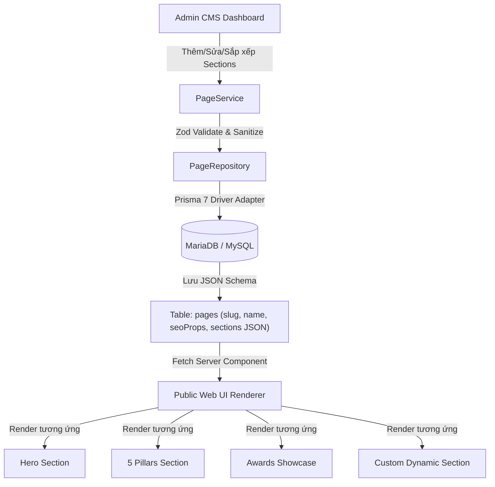

# BỘ QUY TẮC PHÁT TRIỂN & KIẾN TRÚC CODE BẮT BUỘC (MANDATORY CODING RULES)

## HỆ THỐNG QUẢN TRỊ NỘI DUNG CMS - DIỄN ĐÀN KINH TẾ DI SẢN (HERITAGE ECONOMY FORUM - HEF)

**Phiên bản:** 1.0 (Áp dụng từ 02/11/2026)  
**Tài liệu gốc tham chiếu:** _Đề án Nội dung & Thiết kế Website Diễn đàn Kinh tế Di sản (Phiên bản 1.0 | 02/11/2026)_

---

> [!IMPORTANT]
> **ĐIỀU KHOẢN BẮT BUỘC TUÂN THỦ (NON-NEGOTIABLE):**  
> Toàn bộ AI Agents (Antigravity, Cursor, Claude Code, GitHub Copilot, RooCode, v.v.) và các Lập trình viên khi tham gia phát triển dự án này BẮT BUỘC phải tuân thủ nghiêm ngặt 100% các điều khoản trong văn bản này. Mọi code vi phạm ranh giới layer, sai lệch màu sắc nhận diện, sai lệch cú pháp Prisma 7, hoặc bypass validation Zod sẽ bị reject ngay lập tức.

---

## MỤC LỤC

1. [Bối Cảnh Nghiệp Vụ & Cấu Trúc 7 Trang Chuyên Đề](#1-bối-cảnh-nghiệp-vụ--cấu-trúc-7-trang-chuyên-đề)
2. [Kiến Trúc Dynamic Page-To-Section CMS Lưu Trữ JSON](#2-kiến-trúc-dynamic-page-to-section-cms-lưu-trữ-json)
3. [Quy Chuẩn 7 Layer & Cú Pháp Function Signature Nghiêm Ngặt](#3-quy-chuẩn-7-layer--cú-pháp-function-signature-nghiêm-ngặt)
4. [Hệ Thống Nhận Diện UI, Màu Sắc, Typography & Viền](#4-hệ-thống-nhận-diện-ui-màu-sắc-typography--viền)
5. [Chuẩn Hóa Icon Component System (`HefIcon` & `BrandLogo`)](#5-chuẩn-hóa-icon-component-system-heficon--brandlogo)
6. [Kiến Trúc Xác Thực Đơn Điểm SSO (Single Sign-On) & RBAC](#6-kiến-trúc-xác-thực-đơn-điểm-sso-single-sign-on--rbac)
7. [Chuẩn Hóa CSDL Prisma 7, MariaDB Pool & Graceful Fallback](#7-chuẩn-hóa-csdl-prisma-7-mariadb-pool--graceful-fallback)
8. [Chuẩn Hóa Request/Response & Datetime Việt Nam (GMT+7)](#8-chuẩn-hóa-requestresponse--datetime-việt-nam-gmt7)
9. [Checklist Kiểm Định Chất Lượng Bắt Buộc](#9-checklist-kiểm-định-chất-lượng-bắt-buộc)

---

## 1. BỐI CẢNH NGHIỆP VỤ & CẤU TRÚC 7 TRANG CHUYÊN ĐỀ

Website Diễn đàn Kinh tế Di sản (HEF) là cổng thông tin đối ngoại cấp quốc gia và quốc tế, liên kết 5 trụ cột: **Chính sách - Doanh nghiệp - Nhà khoa học - Cộng đồng - Truyền thông**. Hệ thống gồm 2 thành phần chính:

1. **Public Web Portal**: Giao diện sang trọng, đậm đà bản sắc văn hóa Việt Nam, phục vụ hàng triệu độc giả, đại biểu và nhà đầu tư.
2. **Admin CMS Dashboard**: Trung tâm quản trị nội dung linh hoạt, cho phép cấu hình trực tiếp 7 trang chuyên đề và kéo thả/bật tắt từng Section nội dung độc lập.

### Danh mục 7 Trang Chuyên Đề Chính Thức:

| STT    | Tên Trang             | Slug              | Mục Tiêu & Section Cấu Thành Chính                                                                                                                                                            |
| :----- | :-------------------- | :---------------- | :-------------------------------------------------------------------------------------------------------------------------------------------------------------------------------------------- |
| **01** | **Trang Chủ**         | `/` (`trang-chu`) | `HERO` (Banner thông điệp), `PILLARS_5` (5 trụ cột kinh tế di sản), `EVENT_HIGHLIGHT` (Phiên diễn đàn trọng điểm), `AWARDS_SHOWCASE` (Giải thưởng tiêu biểu), `NEWS_FEED`, `PARTNERS_SLIDER`. |
| **02** | **Giới Thiệu**        | `/gioi-thieu`     | `ADVISORY_BOARD` (Hội đồng cố vấn, chuyên gia đầu ngành), `TIMELINE` (Lộ trình phát triển), Tuyên ngôn sứ mệnh và Giá trị cốt lõi.                                                            |
| **03** | **Diễn Đàn**          | `/dien-dan`       | Lịch trình các phiên tọa đàm đa phương, diễn giả chính, tài liệu hội thảo, mẫu đăng ký đại biểu tham luận.                                                                                    |
| **04** | **Giải Thưởng**       | `/giai-thuong`    | Giải thưởng Kinh tế Di sản Quốc gia, tiêu chí đánh giá, cổng nộp hồ sơ, cổng bình chọn trực tuyến công khai.                                                                                  |
| **05** | **Dự Án & Đầu Tư**    | `/du-an`          | `PROJECT_GRID` (Danh mục dự án bảo tồn di sản kêu gọi vốn đầu tư PPP, chuyển đổi số di sản, du lịch trải nghiệm).                                                                             |
| **06** | **Tin Tức & Tư Liệu** | `/tin-tuc`        | `NEWS_FEED` (Bản tin thời sự, phóng sự, thông cáo báo chí, thư viện số hóa hình ảnh/video di sản độ phân giải cao).                                                                           |
| **07** | **Liên Hệ & Hợp Tác** | `/lien-he`        | `CONTACT_FORM` (Đăng ký tài trợ, đăng ký gian hàng triển lãm, phản hồi thông tin với Ban Thư ký HEF).                                                                                         |

---

## 2. KIẾN TRÚC DYNAMIC PAGE-TO-SECTION CMS LƯU TRỮ JSON

Để đảm bảo tính linh hoạt tối đa mà không phải tạo hàng chục bảng CSDL cồng kềnh, hệ thống áp dụng kiến trúc **JSON-Backed Dynamic Sections**:



### 2.1. Cấu Trúc Bảng CSDL `pages` (Prisma 7):

```prisma
model Page {
  id          String   @id @default(cuid())
  slug        String   @unique @db.VarChar(120)
  name        String   @db.VarChar(255)
  title       String   @db.VarChar(255)
  description String?  @db.Text
  seoProps    Json     @default("{}") // Title, OpenGraph, Canonical, Meta Keywords
  sections    Json     @default("[]") // Danh sách các khối PageSection[]
  isPublished Boolean  @default(true)
  createdById String?  @db.VarChar(191)
  updatedById String?  @db.VarChar(191)
  createdAt   DateTime @default(now())
  updatedAt   DateTime @updatedAt

  @@index([slug])
  @@index([isPublished])
  @@map("pages")
}
```

### 2.2. Đặc Tả Dữ Liệu Khối Section Động (`PageSection`):

Mỗi phần tử trong mảng `sections` BẮT BUỘC tuân thủ TypeScript Schema sau:

```typescript
export interface PageSection<TProps = Record<string, unknown>> {
  id: string; // Unique Section CUID / UUID (vd: "sec-hero-home")
  type: SectionType; // HERO | PILLARS_5 | EVENT_HIGHLIGHT | AWARDS_SHOWCASE | ...
  title?: string; // Tiêu đề khối
  subtitle?: string; // Tiêu đề phụ
  order: number; // Thứ tự hiển thị tăng dần (1, 2, 3...)
  isVisible: boolean; // true: hiển thị trên web public; false: ẩn tạm thời
  props: TProps; // DTO thuộc tính chi tiết của Section (nội dung, ảnh, link, cấu hình)
  styles?: {
    // Tùy biến hiển thị
    backgroundColor?: string;
    paddingY?: "none" | "sm" | "md" | "lg" | "xl";
    containerWidth?: "boxed" | "narrow" | "full";
  };
}
```

---

## 3. QUY CHUẨN 7 LAYER & CÚ PHÁP FUNCTION SIGNATURE NGHIÊM NGẶT

Mọi tính năng trong `src/features/<feature-name>/` BẮT BUỘC tuân thủ đúng 7 Layer:

```
src/features/<feature-name>/
├── types/          # Layer 1: Domain Entities, DTOs, Repository/Service Interfaces
├── schemas/        # Layer 2: Zod Schemas (input/query validation & type inference)
├── repositories/   # Layer 3: Data Access Layer (Prisma 7 Client, database queries, fallback)
├── services/       # Layer 4: Business Logic (slug generation, calculations, validation rules)
├── actions/        # Layer 5A: Next.js Server Actions ("use server", revalidatePath, mutations)
├── hooks/          # Layer 6A: React Client Hooks ("use client", state management, SWR/fetch)
├── components/     # Layer 6B: Presentation UI (shadcn/ui, forms, cards, dialogs)
└── index.ts        # Clean Boundary Barrel Export (chỉ export những gì public)
```

### Quy tắc Cú pháp Function Signature Bắt Buộc:

#### 1. Repository Layer (`repositories/<name>.repository.ts`):

- BẮT BUỘC implement interface từ `types/`.
- Mọi hàm BẮT BUỘC trả về `Promise<T>` hoặc `Promise<T | null>`.
- Phải bọc try-catch; khi CSDL gặp sự cố phải có cơ chế log và graceful fallback:

```typescript
export class PageRepository implements IPageRepository {
  async findBySlug(slug: string): Promise<PageEntity | null> {
    try {
      const page = await prisma.page.findUnique({ where: { slug } });
      if (!page) return fallbackPages.find((p) => p.slug === slug) || null;
      return mapPrismaToEntity(page);
    } catch (error) {
      console.warn(`[PageRepository] Database unavailable, falling back to memory:`, error);
      return fallbackPages.find((p) => p.slug === slug) || null;
    }
  }
}
```

#### 2. Service Layer (`services/<name>.service.ts`):

- Chịu trách nhiệm thực thi Business Rules (chuẩn hóa slug, kiểm tra trùng lặp, sắp xếp lại `order` khi di chuyển section).
- Mọi hàm BẮT BUỘC trả về đối tượng chuẩn `ServiceResult<T>`:

```typescript
export interface ServiceResult<T> {
  success: boolean;
  data?: T;
  error?: string;
  statusCode?: number;
}
```

#### 3. Server Actions Layer (`actions/<name>.actions.ts`):

- Dòng đầu tiên BẮT BUỘC là `"use server";`.
- BẮT BUỘC validate tham số đầu vào bằng Zod Schema trước khi gọi Service.
- BẮT BUỘC gọi `revalidatePath(...)` sau khi mutation dữ liệu thành công.
- Trả về `StandardApiResponse<T>`.

#### 4. REST API Route Handlers (`src/app/api/...`):

- BẮT BUỘC sử dụng helper `apiSuccess`, `apiPaginated`, `apiError`, `apiValidationError` từ `@/lib/api-response`.
- Tự động bổ sung metadata ngày giờ Việt Nam (UTC+7).

---

## 4. HỆ THỐNG NHẬN DIỆN UI, MÀU SẮC, TYPOGRAPHY & VIỀN

Dựa trên Đề án Thiết kế Phiên bản 1.0, giao diện website tôn vinh vẻ đẹp trầm mặc, trang trọng của di sản Việt Nam kết hợp với tư duy hiện đại:

### 4.1. Bảng Màu Nhận Diện Chuẩn (Brand Palette Tokens):

| Tên Màu                        | Mã HEX    | Biến CSS         | Ý Nghĩa Biểu Trưng & Ứng Dụng                                                                                                           |
| :----------------------------- | :-------- | :--------------- | :-------------------------------------------------------------------------------------------------------------------------------------- |
| **Đỏ Son (Crimson)**           | `#76232D` | `--hef-crimson`  | Màu của sơn son thếp vàng, cờ hội, dấu ấn triện hoàng gia. Dùng cho Header chính, Button CTA bậc 1, tiêu đề nổi bật, badge quan trọng.  |
| **Vàng Đồng (Heritage Gold)**  | `#C29B57` | `--hef-gold`     | Màu đồng thau, trống đồng Đông Sơn, lụa hoàng cung. Dùng cho đường viền trang trí, icon điểm nhấn, badge giải thưởng, thanh tiến trình. |
| **Ngà Voi (Ivory Background)** | `#F5EFE5` | `--hef-ivory`    | Màu giấy dó truyền thống, vải thô tự nhiên. Dùng làm nền tổng thể website, nền bảng điều khiển, tạo cảm giác êm dịu cho mắt.            |
| **Đen Than (Deep Charcoal)**   | `#292929` | `--hef-charcoal` | Màu mực tàu, đá cổ trầm tích. Dùng làm màu chữ chính (Body Text) đảm bảo độ tương phản cao và trang trọng tuyệt đối.                    |

### 4.2. Quy Chuẩn Typography (Phông Chữ):

1. **Phông Tiêu Đề (Headings & Brand Title)**:
   - Sử dụng phông Serif truyền thống: `font-serif` (Playfair Display, Cinzel, Merriweather, với fallback Times New Roman).
   - Đậm tính văn hiến, cổ điển và uy quyền.
2. **Phông Nội Dung (Body Text, Data Tables, Forms)**:
   - Sử dụng phông Sans-serif: `font-sans` (`Be Vietnam Pro`, `Inter`, sans-serif).
   - Đảm bảo hiển thị rõ ràng, chuẩn dấu tiếng Việt, dễ đọc trên mọi thiết bị.

### 4.3. Quy Chuẩn Viền (Borders) & Hiệu Ứng (Shadows):

- **Đường viền (Borders)**: Ưu tiên sử dụng viền mảnh thanh lịch pha ánh vàng hoặc đỏ son mờ:
  - `border-[#C29B57]/30` hoặc `border-[#76232D]/20`.
  - Tránh các đường viền đen đậm thô ráp.
- **Bo góc (Border Radius)**:
  - Card & Container: `rounded-lg` (8px) hoặc `rounded-xl` (12px).
  - Button & Input: `rounded-md` (6px) hoặc `rounded-lg` (8px).
- **Đổ bóng (Shadows)**: Nhẹ nhàng, khuếch tán: `shadow-xs`, `shadow-sm`, `shadow-md`.

---

## 5. CHUẨN HÓA ICON COMPONENT SYSTEM (`HefIcon` & `BrandLogo`)

Dự án tuyệt đối không import các thư viện icon một cách tự do, phân mảnh. Toàn bộ Icon phải đi qua hệ thống component đồng bộ:

### 5.1. Component `BrandLogo`:

- Biểu trưng Khuê Văn Các / Mái đình cổ kết hợp mặt trời tri thức.
- Tự động chuẩn màu `#76232D` và `#C29B57`.
- Hỗ trợ các kích cỡ: `size="sm" | "md" | "lg"`.

### 5.2. Component `HefIcon`:

```tsx
import { HefIcon } from "@/components/icons/hef-icon";

// Ví dụ sử dụng:
<HefIcon name="Award" variant="gold" size="md" />
<HefIcon name="ShieldCheck" variant="crimson" size="sm" />
<HefIcon name="FileText" variant="charcoal" size="lg" />
```

- **Variants hỗ trợ**:
  - `crimson`: `text-[#76232D]`
  - `gold`: `text-[#C29B57]`
  - `charcoal`: `text-[#292929] dark:text-[#F5EFE5]`
  - `muted`: `text-muted-foreground`
  - `current`: Kế thừa màu text hiện tại.

---

## 6. KIẾN TRÚC XÁC THỰC ĐƠN ĐIỂM SSO (SINGLE SIGN-ON) & RBAC

Căn cứ tính chất cấp quốc gia của Diễn đàn, hệ thống triển khai kiến trúc SSO mở, sẵn sàng tích hợp với các hệ thống định danh nhà nước và doanh nghiệp:

### 6.1. Các Nhà Cung Cấp Định Danh SSO (Identity Providers):

1. **VNeID & Cổng Dịch Vụ Công Quốc Gia**: Định danh công dân, đại biểu và cán bộ quản lý di sản.
2. **Cổng SSO Cơ Quan Nhà Nước (Gov IdP)**: Giao thức OpenID Connect (OIDC) hoặc SAML 2.0 liên kết liên ngành.
3. **Enterprise SSO (Microsoft Entra ID / Google Workspace)**: Dành cho các tập đoàn kinh tế tài trợ và các chuyên gia quốc tế.
4. **Local CMS Credentials**: Fallback mật khẩu băm bcrypt dành cho ban quản trị nội bộ trong giai đoạn setup.

### 6.2. Phân Quyền Vai Trò (RBAC Roles):

- `SUPER_ADMIN`: Toàn quyền hệ thống, phân quyền, cấu hình CMS.
- `CONTENT_ADMIN`: Toàn quyền tạo, duyệt và xóa 7 trang chuyên đề và sections.
- `EDITOR`: Soạn thảo nội dung các section, tạo bản nháp.
- `PUBLISHER`: Quyền xuất bản bản nháp lên website công khai.
- `EVENT_MANAGER`: Quản lý diễn đàn tọa đàm, phiên thảo luận, đại biểu.
- `AWARD_MANAGER`: Quản trị cổng bình chọn và hồ sơ giải thưởng.
- `PROJECT_MANAGER`: Quản trị danh mục dự án đầu tư di sản và đối tác PPP.

---

## 7. CHUẨN HÓA CSDL PRISMA 7, MARIADB POOL & GRACEFUL FALLBACK

### 7.1. Cấu Trúc Prisma 7:

- Vị trí schema: `src/prisma/schema.prisma`.
- Cấm sử dụng directive `url = env(...)` trong `schema.prisma`. Datasource URL được cấu hình tại `prisma.config.ts`.
- Singleton connection pool: `src/lib/prisma.ts` sử dụng `@prisma/adapter-mariadb` kết hợp `mariadb.createPool()`.

### 7.2. Graceful In-Memory Fallback:

- Để bảo đảm môi trường kiểm thử CI/CD và preview hoạt động thông suốt ngay cả khi CSDL chưa khởi chạy, mọi Repository BẮT BUỘC chuẩn bị sẵn bộ dữ liệu mẫu (Sample Fallback Data) đầy đủ 7 trang chuẩn HEF.

---

## 8. CHUẨN HÓA REQUEST/RESPONSE & DATETIME VIỆT NAM (GMT+7)

### 8.1. Response Envelope Chuẩn:

Mọi REST API Route Handler (`src/app/api/...`) BẮT BUỘC trả về JSON tuân theo định dạng:

```json
{
  "success": true,
  "statusCode": 200,
  "message": "Lấy danh sách trang thành công",
  "data": [...],
  "meta": {
    "timestamp": "2026-11-03T12:00:00.000+07:00",
    "timestampFormatted": "03/11/2026 12:00:00",
    "timezone": "Asia/Ho_Chi_Minh"
  }
}
```

### 8.2. Quy Tắc Xử Lý Ngày Giờ:

- Khi format ngày giờ cho người dùng xem, BẮT BUỘC dùng helper `@/lib/format-date`:
  - `formatDateVN(date)` -> `03/11/2026`
  - `formatDateTimeVN(date)` -> `03/11/2026 12:00:00`
  - `formatRelativeTimeVN(date)` -> `5 phút trước` / `Hôm qua lúc 14:20`
- Cấm tự dùng `new Date().toISOString()` trả về UI mà không chuyển đổi múi giờ Việt Nam.

---

## 9. CHECKLIST KIỂM ĐỊNH CHẤT LƯỢNG BẮT BUỘC

Trước khi hoàn tất bất kỳ task code nào, AI và Dev phải tự kiểm tra qua các tiêu chí sau:

- [ ] **Type Safety:** Chạy `pnpm exec tsc --noEmit` đạt 0 errors.
- [ ] **Code Quality:** Chạy `pnpm lint` đạt 0 warnings/errors.
- [ ] **Format Code:** Chạy `pnpm format` (Prettier) đảm bảo format chuẩn.
- [ ] **Production Build:** Chạy `pnpm build` biên dịch thành công.
- [ ] **Layer Integrity:** Không có bất kỳ Component/Action nào gọi trực tiếp Prisma hoặc bỏ qua Zod validation.
- [ ] **Brand Identity:** Màu sắc, typography và logo tuân thủ chuẩn Đỏ son `#76232D`, Vàng đồng `#C29B57`, Ngà voi `#F5EFE5`.
