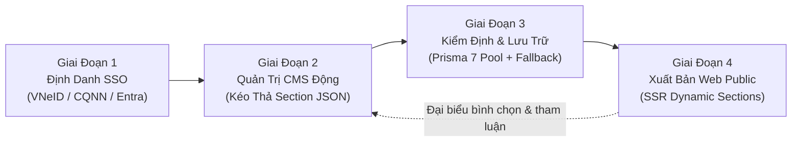
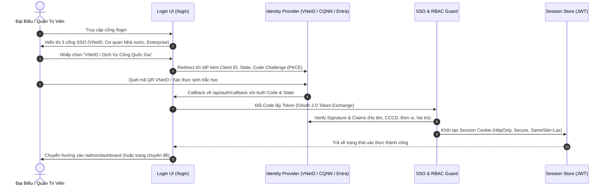
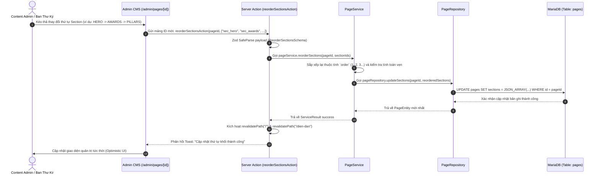
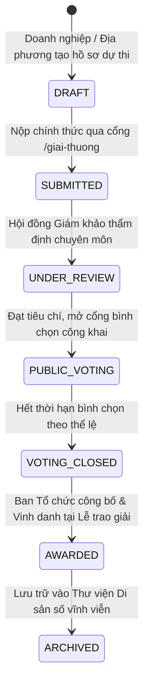

# ĐẶC TẢ TOÀN BỘ LUỒNG DỰ ÁN (PROJECT END-TO-END WORKFLOW)

## HỆ THỐNG QUẢN TRỊ NỘI DUNG CMS - DIỄN ĐÀN KINH TẾ DI SẢN (HERITAGE ECONOMY FORUM - HEF)

**Phiên bản:** 1.0 (Áp dụng từ 03/11/2026)  
**Tài liệu liên quan:** [`docs/HEF_CMS_CODING_RULES.md`](./HEF_CMS_CODING_RULES.md)  
**Sơ đồ kiến trúc Archify tương tác:** [`docs/architecture/hef-architecture.html`](./architecture/hef-architecture.html)  
**Sơ đồ luồng dự án Archify tương tác:** [`docs/architecture/hef-project-flow.html`](./architecture/hef-project-flow.html)

---

## 1. TỔNG QUAN VÒNG ĐỜI NGHIỆP VỤ (END-TO-END PROJECT FLOW)

Vòng đời vận hành toàn bộ hệ thống Diễn đàn Kinh tế Di sản trải qua 4 giai đoạn khép kín:



---

## 2. FLOW 1: ĐỊNH DANH & XÁC THỰC ĐƠN ĐIỂM (SSO AUTHENTICATION FLOW)



---

## 3. FLOW 2: QUẢN TRỊ TRANG & CẤU HÌNH KHỐI SECTION ĐỘNG (ADMIN CMS FLOW)



---

## 4. FLOW 3: PHÂN PHỐI & HIỂN THỊ TRANG WEB ĐỘNG (DYNAMIC SSR DELIVERY FLOW)

```mermaid
flowchart TD
    Req([Độc Giả truy cập https://disan.vn/dien-dan]) --> AppRouter[Next.js App Router: src/app/dien-dan/page.tsx]
    AppRouter --> FetchData[Gọi pageService.getPageBySlug 'dien-dan']
    FetchData --> TryDB{Kết nối MariaDB Pool?}

    TryDB -- Thành công --> ReadDB[(MariaDB: Đọc cột sections JSON)]
    TryDB -- Sự cố / Timeout --> ReadFallback[Kích hoạt Graceful Fallback: DEFAULT_HEF_PAGES]

    ReadDB --> ParseJSON[Trích xuất mảng PageSection[] đã sắp xếp]
    ReadFallback --> ParseJSON

    ParseJSON --> LoopSections{Duyệt từng Section trong mảng}
    LoopSections -->|type: HERO| R1["Render &lt;HeroSection props={...} /&gt;"]
    LoopSections -->|type: PILLARS_5| R2["Render &lt;Pillars5Section props={...} /&gt;"]
    LoopSections -->|type: EVENT_HIGHLIGHT| R3["Render &lt;EventHighlightSection props={...} /&gt;"]
    LoopSections -->|type: AWARDS_SHOWCASE| R4["Render &lt;AwardsShowcaseSection props={...} /&gt;"]
    LoopSections -->|type: PROJECT_GRID| R5["Render &lt;ProjectGridSection props={...} /&gt;"]
    LoopSections -->|type: NEWS_FEED| R6["Render &lt;NewsFeedSection props={...} /&gt;"]

    R1 --> Assemble[Tổng hợp HTML Layout với Design Tokens Di Sản]
    R2 --> Assemble
    R3 --> Assemble
    R4 --> Assemble
    R5 --> Assemble
    R6 --> Assemble

    Assemble --> InjectTheme["Áp dụng Đỏ son #76232D, Vàng đồng #C29B57, Ngà voi #F5EFE5"]
    InjectTheme --> ClientBrowser([Truyền tải HTML về Trình duyệt Độc giả])
```

---

## 5. FLOW 4: VÒNG ĐỜI HỒ SƠ GIẢI THƯỞNG & BÌNH CHỌN (AWARDS LIFECYCLE)



---

## 6. SƠ ĐỒ TRỰC QUAN HÓA ARCHIFY MULTI-VIEW

Toàn bộ các luồng trên đã được biên dịch thành công cụ tương tác trực quan:

- **File HTML tương tác**: [`docs/architecture/hef-architecture.html`](./architecture/hef-architecture.html)
- Có thể chuyển đổi qua lại giữa **Modular Architecture** và **Project End-to-End Flow**.
- Lệnh biên dịch lại sơ đồ:
  ```bash
  pnpm archify:generate
  ```
